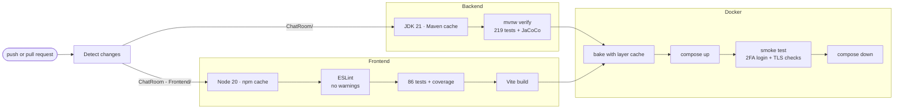
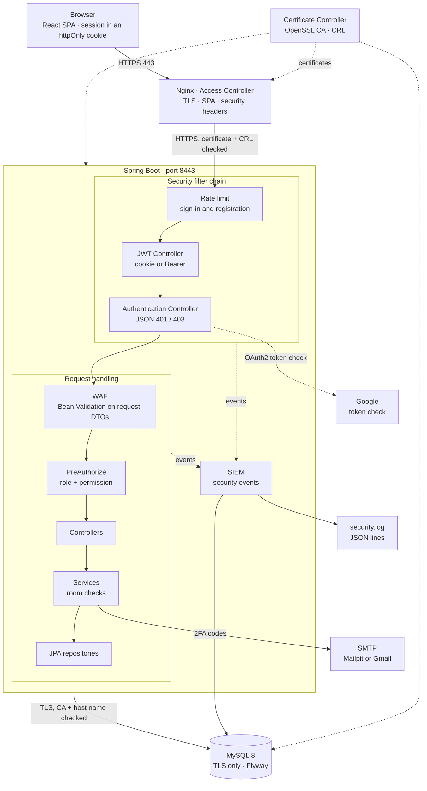
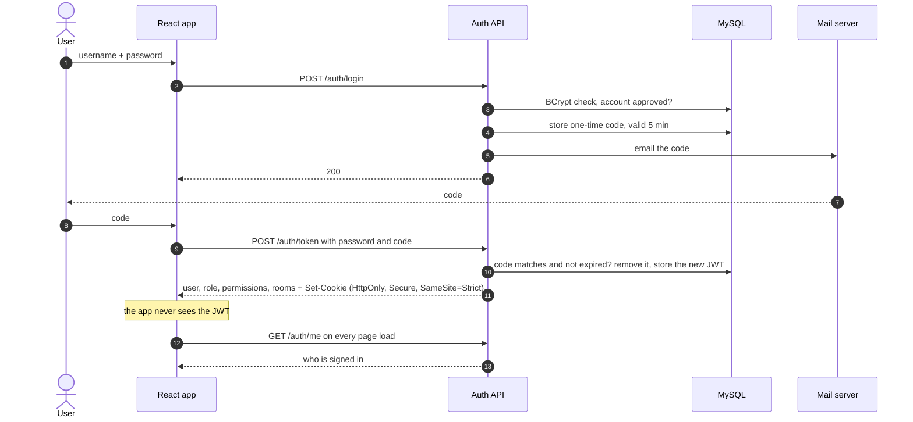
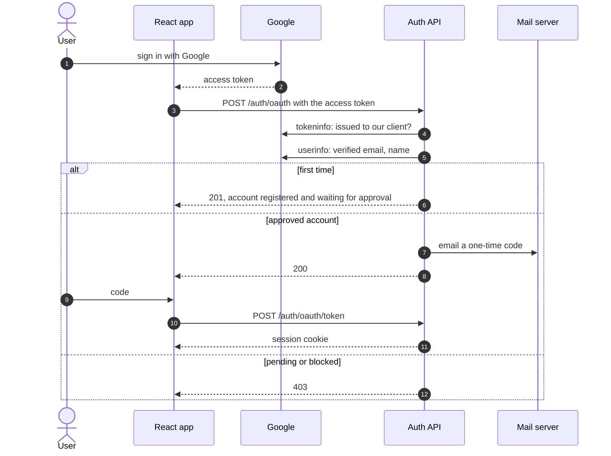
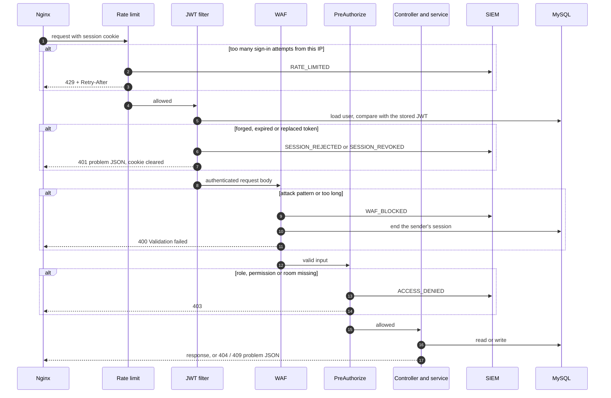
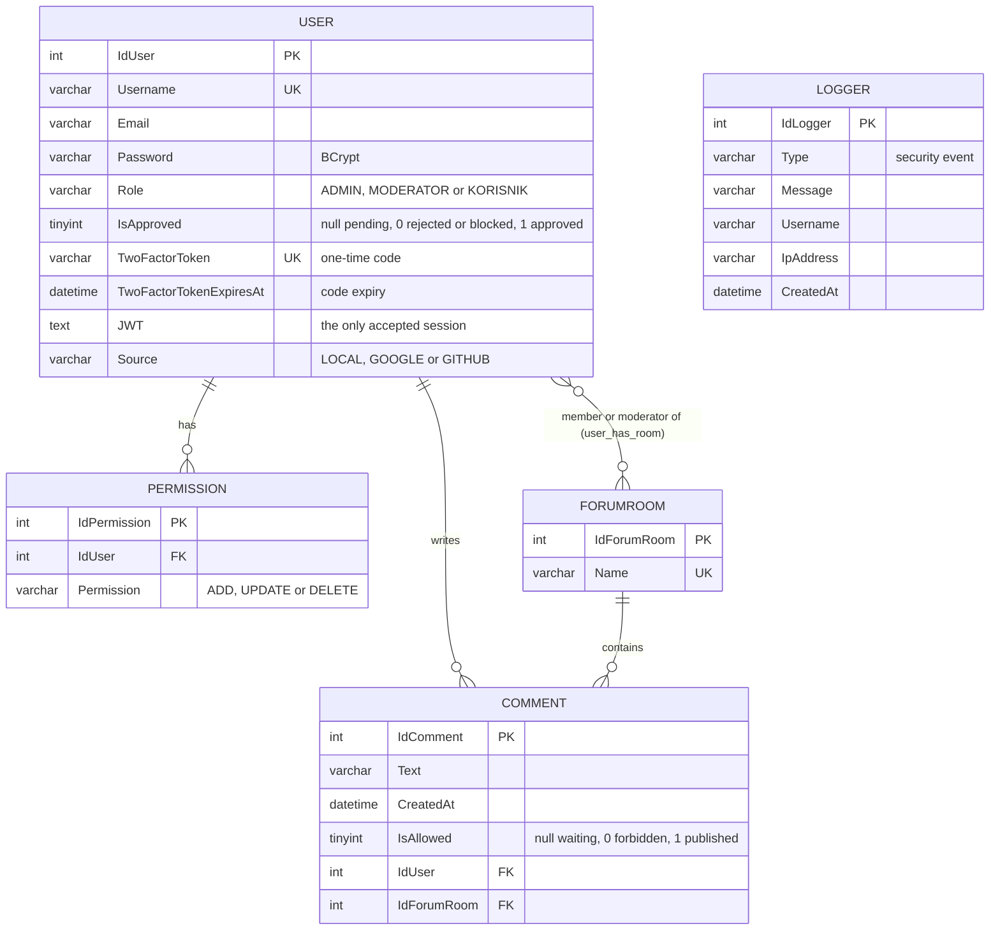

<div align="center">

# 💬 Chat Room

[](https://github.com/pero-grubac/Chat-room/actions/workflows/ci.yml)


**A moderated discussion forum with role-based access, two-factor login, a WAF, a SIEM and TLS between every component.**


</div>

---

## 📌 Project Overview

**Chat Room** is an internet forum where registered users discuss topics in rooms (Science, Culture, Sports, Music by default). Nobody gets in on their own: a new account waits until an administrator approves it and decides its role, permissions and rooms. Every new comment waits for a moderator of that room before anyone else sees it.

Signing in takes two steps: username and password, then a one-time code sent by email. Google sign-in follows the same rule.

| Who | How they get in | What they can do |
|-----|-----------------|------------------|
| 🌍 **Guest** | Nobody signs in | Register an account and wait for approval |
| 💻 **User** (`ROLE_KORISNIK`) | Approved by an admin, then password + emailed code | Read the latest 20 approved comments of every room (text, author, time), post comments |
| 🛠️ **Moderator** (`ROLE_MODERATOR`) | Same | Everything a user can, plus publish, adjust, forbid or delete pending comments **in the rooms assigned to them**, as their permissions allow |
| 🔑 **Administrator** (`ROLE_ADMIN`) | Same | Everything in every room, plus approve or reject registrations, block or restore access, set roles, permissions and rooms, read the security log |

Moderators get any combination of three permissions: **ADD** (publish or forbid comments), **UPDATE** (adjust comments) and **DELETE** (delete comments). Administrators always have all three, regular users none.

---

## 📋 Project Requirements

The system implements the [project assignment](2024_02_SNI.pdf) (Sigurnost na internetu, ETF Banja Luka):

| Requirement | Implementation |
|-------------|----------------|
| Rooms Science, Culture, Sports, Music | Seeded by the Flyway migration `V2__seed.sql`; admins and moderators can add more |
| Groups Administrator, Moderator, Forum user | `ROLE_ADMIN`, `ROLE_MODERATOR`, `ROLE_KORISNIK`, enforced with `@PreAuthorize` on every endpoint |
| Admin part: allow or deny access | Approve or reject registrations (`/users/approve`); block or restore an approved account (`/users/access`), which ends its session at once |
| Admin part: user group and permission set per area | Role, the exact set of `ADD`/`UPDATE`/`DELETE` and the rooms a moderator manages (`/users/changeRole`) |
| Moderator part: publish (with or without adjusting) or forbid a comment | Moderation queue per room: publish, forbid, adjust, delete; limited to the moderator's rooms |
| Forum part: last 20 comments per room with text, user and time | `GET /comments/{roomId}` returns the 20 newest published comments |
| Registration approved by the admin, user notified by email | Approval (with any role), rejection, blocking and unblocking all send an email |
| Two-factor sign-in with an emailed code | Password, then a one-time code that expires after 5 minutes and is gone after one attempt |
| Access Controller | Nginx (TLS, routing) in front of the Spring filter chain (rate limit, JWT, WAF, method security) |
| Authentication Controller | `AuthenticationService`, `TwoFactorService`, Spring Security `AuthenticationManager` |
| JWT Controller | `JwtService` issues and validates tokens; `JwtAuthenticationFilter` accepts only the token stored for the user |
| WAF: rules for input length and forbidden sequences; the session can be closed | `WafRule` patterns and column lengths on every request body; a hit ends the sender's session and the web app signs the user out |
| Protected communication between the user and the system and between components | HTTPS browser → Nginx, HTTPS Nginx → backend with certificate and CRL check, TLS backend → MySQL with CA and host name check |
| Certificate Controller: issue, track and revoke certificates for all components | `certificates/certificate-controller.sh`, an OpenSSL CA: `issue`, `list`, `revoke` with a published CRL |
| SIEM: monitor and log all security-sensitive requests | `SecurityEventService`: 18 event types to `logs/security.log` (JSON lines) and the database, browsable by admins |
| Sign-in with an external OAuth2 account | Google sign-in; the server verifies the access token with Google before trusting it |

---

## ✨ Features

- 📝 **Registration with approval**: the admin approves or rejects each account and picks its role, permissions and rooms; the user is emailed either way. Passwords need 8 to 72 characters with upper and lower case, a digit and a special character, checked on the server too
- 🚫 **Access control at any time**: an approved account can be blocked (signed out at once, sign-in refused) and restored later with the same role
- 🔐 **Two-factor login**: password first, then a one-time code by email that expires after 5 minutes and is gone after one attempt
- 🌐 **Google sign-in**: the access token is checked with Google, must belong to this app's client and to a verified email
- 🏠 **Permissions per room**: moderators manage only the rooms assigned to them, with exactly the permissions they were given
- ✅ **Comment moderation**: new comments stay hidden until a moderator publishes them, optionally adjusted, or forbids them; edits keep the original author and date
- 🍪 **httpOnly session cookie**: the JWT never reaches page scripts; `SameSite=Strict` keeps other sites from using it
- 🎫 **Revocable sessions**: the active token is stored with the user, so logout, blocking, a WAF hit or a newer sign-in end a session on the server
- 🛡️ **Application firewall (WAF)**: text fields are checked against attack patterns (SQL injection, XSS, template and command injection, path traversal…) and column lengths; a hit ends the sender's session
- 🚦 **Rate limiting**: sign-in and registration are limited per client IP (`429` with `Retry-After`)
- 📊 **SIEM**: every security-sensitive event is recorded with user, IP and time, in a JSON log file and the database, and shown to admins in the security log
- 🔏 **Internal PKI**: an OpenSSL certificate authority issues, tracks and revokes the certificates of Nginx, the backend and MySQL
- 🔒 **TLS everywhere**: browser → Nginx, Nginx → backend and backend → MySQL are all encrypted and verified
- 📋 **Consistent errors**: every failure is an [RFC 7807](https://www.rfc-editor.org/rfc/rfc7807) problem response with a fitting status (`400`, `401`, `403`, `404`, `409`, `429`…)
- 🗃️ **Versioned schema** with Flyway; existing databases are adopted automatically
- 🐳 **One-command setup** with Docker Compose, including a mail catcher for the login codes

### 🔒 Permission matrix

All endpoints are served under `/api` (for example `https://localhost/api/forumrooms`).

| Action | Endpoint | User | Moderator | Admin |
|--------|----------|:----:|:---------:|:-----:|
| Register | `POST /users/add` | public | public | public |
| Sign in (both steps, also with Google), sign out | `POST /auth/login`, `/auth/token`, `/auth/oauth`, `/auth/oauth/token`, `/auth/logout` | public | public | public |
| Who am I (role, permissions, rooms) | `GET /auth/me` | ✅ | ✅ | ✅ |
| List rooms | `GET /forumrooms` | ✅ | ✅ | ✅ |
| Read the latest 20 published comments | `GET /comments/{roomId}` | ✅ | ✅ | ✅ |
| Post a comment (goes to moderation) | `POST /comments/create` | ✅ | ✅ | ✅ |
| Edit own profile | `PUT /users/update` | ✅ | ✅ | ✅ |
| Create, rename, delete rooms | `/forumrooms/create`, `/update`, `/delete/{id}` | ❌ | ✅ | ✅ |
| See a room's moderation queue | `GET /comments/requests/{roomId}` | ❌ | own rooms | ✅ |
| Publish or forbid a comment | `PUT /comments/approve` | ❌ | own rooms + `ADD` | ✅ |
| Adjust a comment | `PUT /comments/update` | ❌ | own rooms + `UPDATE` | ✅ |
| Delete a comment | `DELETE /comments/delete/{id}` | ❌ | own rooms + `DELETE` | ✅ |
| List all users | `GET /users` | ❌ | ❌ | ✅ |
| Registrations, approve, block or restore, role and rooms, delete | `/users/requests`, `/approve`, `/access`, `/changeRole`, `/delete/{id}` | ❌ | ❌ | ✅ |
| Security log | `GET /security-events` | ❌ | ❌ | ✅ |

These rules are enforced on the server. The web app only hides what a role cannot use.

---

## 🛠️ Tech Stack

| Layer | Technology | Usage |
|-------|------------|-------|
| Frontend | React 18, Redux Toolkit, React Router 6, Ant Design | Single-page app, session state, routing |
| Build | Vite 5 | Dev server with API proxy, production bundle |
| Backend | Spring Boot 3.2, Java 21 | REST API |
| Security | Spring Security, JJWT | Session cookie, JWT filter, method security, rate limit |
| OAuth2 | Google Identity (`@react-oauth/google`), Spring `RestClient` | Google sign-in, token verification with Google |
| Validation | Jakarta Bean Validation | Custom `@BannedWordsConstraint` (the WAF) |
| Persistence | Spring Data JPA, Hibernate, MySQL 8, Flyway | Data, relations, schema migrations |
| SIEM and logging | Logback, Spring AOP | Security events (JSON lines + database), application log |
| PKI | OpenSSL | Internal CA, certificates, CRL, Java truststore |
| Mail | Spring Mail; Mailpit locally | 2FA codes and account notices |
| Reverse proxy | Nginx | TLS termination, static files, `/api` routing, upstream certificate checks, security headers |
| Containers | Docker, Docker Compose | Certificate Controller, MySQL, backend, frontend, Mailpit |
| Tests | JUnit 5, Mockito, MockMvc, H2, Vitest, React Testing Library | Unit, integration and component tests |
| CI | GitHub Actions | Lint, test, coverage, cached Docker build, smoke test |

---

## 📁 Repository Structure

```
Chat-room/
├── ChatRoom/                         Spring Boot backend
│   ├── src/main/java/org/unibl/etfbl/ChatRoom/
│   │   ├── controllers/              REST endpoints (auth, users, forumrooms, comments, security-events)
│   │   ├── security/
│   │   │   ├── jwt/                  JwtService, session cookie, JwtAuthenticationFilter
│   │   │   ├── auth/                 2FA login, one-time codes, Google token verification
│   │   │   ├── waf/                  WAF rules and the @BannedWordsConstraint validator
│   │   │   ├── siem/                 Security events (the SIEM)
│   │   │   ├── ratelimit/            Sign-in rate limit
│   │   │   └── config/               SecurityConfig, JSON 401/403, CORS
│   │   ├── services/                 Business rules (approval, access, roles, rooms, moderation)
│   │   ├── advices/                  Error mapping + application log
│   │   ├── models/                   JPA entities and DTOs
│   │   └── repositories/             Spring Data repositories
│   ├── src/main/resources/db/migration/   Flyway migrations
│   ├── src/test/                     Unit and integration tests (H2)
│   └── Dockerfile
├── ChatRoom - Frontend/
│   ├── chat-room/                    React app (Vite)       → README inside
│   ├── nginx.conf                    TLS, /api proxy with certificate check, headers
│   └── Dockerfile
├── certificates/                     Certificate Controller (OpenSSL CA)
├── scripts/smoke-test.sh             End-to-end check of a running stack
├── .github/workflows/ci.yml          CI pipeline
├── docker-compose.yml
└── .env.example                      Configuration template
```

---

## 🚀 Installation

### Option A · Docker (recommended)

**Prerequisites:** Docker with Docker Compose 2.23 or newer, Git.

**1. Clone the repository**
```bash
git clone https://github.com/pero-grubac/Chat-room.git
cd Chat-room
```

**2. Create your configuration**
```bash
cp .env.example .env
```
Then set `JWT_SIGNING_KEY` in `.env`. It must be Base64 of at least 32 bytes:
```bash
openssl rand -base64 48
```
Everything else works as it is for a local run.

**3. Start everything**
```bash
docker compose up --build -d
```
On the first start the Certificate Controller creates the CA and issues certificates for Nginx, the backend and MySQL, then Flyway creates the schema and the seed data (four rooms and the admin).

**4. Sign in**

| Service | Address |
|---------|---------|
| 💬 App | **https://localhost** |
| 📬 Mail inbox (2FA codes) | **http://localhost:8025** |
| API, directly (this machine only) | https://localhost:8443 |
| MySQL, TLS only (this machine only) | localhost:3306 |

Sign in with the seeded administrator, then open the Mailpit inbox and copy the code:

| Field | Value |
|-------|-------|
| Username | `admin` |
| Password | `admin123` |

> Change this password after the first sign-in. To receive codes in a real mailbox, set `ADMIN_EMAIL` and the Gmail lines in `.env` before the first start.

The browser warns about the certificate until it trusts the project's CA. To trust it, export it and import `chatroom-ca.crt` as a trusted root certificate authority:
```bash
docker compose run --rm certificates export-ca > chatroom-ca.crt
```

**5. Check that it works** (optional)
```bash
bash scripts/smoke-test.sh
```
It signs in as the admin through Nginx with the full 2FA flow, calls protected endpoints, signs out, and checks that every certificate verifies against the CA and that MySQL refuses unencrypted connections.

#### Useful commands

```bash
docker compose logs -f backend                    # follow backend logs
docker compose exec backend tail -f logs/security.log   # follow the SIEM feed
docker compose up --build -d backend              # rebuild one service
docker compose down                               # stop
docker compose down -v                            # stop and delete the database and the CA
```

> **Upgrading from an older version?** A database created by the former `ddl.sql` is adopted by Flyway as version 1, and the newer migrations are applied on top. Nothing to do by hand.

### Option B · Local development

**Prerequisites:** JDK 21, Node.js 20+, Docker (for MySQL and Mailpit only).

**1. Start the database and the mail catcher**
```bash
cp .env.example .env
docker compose up -d --wait mysql mailpit
```

**2. Run the backend** on http://localhost:8443 (plain HTTP, no certificate needed)
```bash
cd ChatRoom
export SPRING_DATASOURCE_USERNAME=root SPRING_DATASOURCE_PASSWORD=root
export SERVER_SSL_ENABLED=false AUTH_COOKIE_SECURE=false FRONTEND_URL=http://localhost:3000
export TOKEN_SIGNING_KEY="$(openssl rand -base64 48)"
export SPRING_MAIL_HOST=localhost SPRING_MAIL_PORT=2525 SPRING_MAIL_USERNAME=dev SPRING_MAIL_PASSWORD=dev
./mvnw spring-boot:run
```
In IntelliJ, put the same variables in the run configuration instead. The connection to MySQL is still encrypted; set `GOOGLE_CLIENT_ID` to try Google sign-in.

**3. Run the frontend** on http://localhost:3000
```bash
cd "ChatRoom - Frontend/chat-room"
npm ci
npm run dev
```
Vite forwards `/api/*` to `localhost:8443`, so the browser sees a single origin, exactly as behind Nginx.

### ⚙️ Configuration

| Variable (`.env`) | Purpose | Default |
|-------------------|---------|---------|
| `MYSQL_ROOT_PASSWORD`, `MYSQL_DATABASE` | MySQL container | `root`, `chatroom` |
| `DB_USERNAME`, `DB_PASSWORD` | Backend database login | `root`, `root` |
| `JWT_SIGNING_KEY` | HS256 key, Base64, at least 32 bytes | **must be set** |
| `MAIL_HOST`, `MAIL_PORT` | SMTP server | `mailpit`, `1025` |
| `MAIL_USERNAME`, `MAIL_PASSWORD` | SMTP login (Gmail: an App Password) | placeholders |
| `ADMIN_EMAIL` | Email of the seeded `admin` account | `admin@gmail.com` |
| `GOOGLE_CLIENT_ID` | Google OAuth client of the web app; the backend accepts only tokens issued to it. Empty turns Google sign-in off | the project's client |

Backend settings with defaults in `application.properties`, each overridable as an environment variable:

| Property | Meaning | Default |
|----------|---------|---------|
| `token.expiration` | Session length | `PT24H` |
| `two-factor.expiration` | Lifetime of an emailed code | `PT5M` |
| `auth.cookie.secure` (`AUTH_COOKIE_SECURE`) | `Secure` flag on the session cookie; `false` only for plain-HTTP development | `true` |
| `rate-limit.auth.requests`, `rate-limit.auth.window` | Sign-in and registration attempts per IP | `10` per `PT1M` |
| `server.ssl.certificate`, `server.ssl.certificate-private-key` | Backend certificate (PEM) | `/pki/backend.crt`, `/pki/backend.key` |

`.env` is ignored by Git. Only `.env.example` is committed.

---

## 🔏 Certificate Controller

`certificates/` is a small OpenSSL certificate authority that runs as a one-shot container before the others start. It keeps its private key in its own volume, gives every component only its own certificate and key, and publishes the CA certificate, a CRL and a Java truststore next to them.

| Component | Certificate names | Used for | Checked by |
|-----------|-------------------|----------|------------|
| Nginx | `localhost`, `frontend` | HTTPS to the browser | the browser (after importing the CA) |
| Backend | `backend` | HTTPS from Nginx | Nginx: CA, name `backend`, CRL |
| MySQL | `mysql` | TLS from the backend; plaintext is refused | Connector/J: `sslMode=VERIFY_IDENTITY` |

```bash
docker compose run --rm certificates list               # every certificate ever issued: valid, revoked, expiry
docker compose run --rm certificates issue backend      # replace a certificate (the old one is revoked)
docker compose run --rm certificates revoke backend     # revoke and publish a new CRL
docker compose run --rm certificates export-ca          # the CA certificate, to trust it in a browser
```

After a revocation, reload Nginx (`docker compose exec frontend nginx -s reload`): it then refuses the revoked backend certificate, and API calls fail with `502` until a new certificate is issued and the backend restarted. Missing or expiring certificates (within 30 days) are issued again on every start.

---

## 📊 SIEM

Every security-sensitive event is recorded by `SecurityEventService` with the user, the client IP (resolved behind Nginx) and the time:

| Severity | Events |
|----------|--------|
| ⚠️ Warning | `LOGIN_FAILED`, `LOGIN_NOT_APPROVED`, `LOGIN_CODE_INVALID`, `SESSION_REJECTED` (forged or expired token), `SESSION_REVOKED` (an older token reused), `ACCESS_DENIED`, `WAF_BLOCKED`, `RATE_LIMITED`, `USER_BLOCKED`, `USER_DELETED` |
| ℹ️ Info | `REGISTERED`, `LOGIN_CODE_SENT`, `LOGIN_SUCCESS`, `LOGOUT`, `USER_APPROVED`, `USER_REJECTED`, `USER_UNBLOCKED`, `ROLE_CHANGED` |

Each event goes to two places:
- `logs/security.log`, one JSON object per line, kept for 90 days, ready for a log shipper such as Filebeat or Fluent Bit:
  ```json
  {"time":"2026-10-21T20:30:43Z","event":"WAF_BLOCKED","severity":"WARN","user":"ana","ip":"172.24.0.1","detail":"Field text, rule HTML_TAG, input: <script>…"}
  ```
- the `logger` table, which administrators browse and filter in the web app (🛡️ **Security log** on the Users page) or through `GET /api/security-events?type=…`.

Recording never fails the request that triggered it, and line breaks in values are neutralised so an attacker cannot forge log entries.

---

## 🧪 Tests

| Suite | Tests | What it covers |
|-------|------:|----------------|
| `SecurityIntegrationTest` | 60 | Full Spring context with H2: 2FA and the httpOnly cookie, bypass attempts, sessions and logout, the permission matrix, approving registrations with every role, password and email rules, moderation per room (publish, adjust, forbid), blocking and restoring access, exact permission sets, room assignment, SIEM records, Google sign-in, error codes, data integrity |
| `WAFTest` | 49 | 24 attack payloads mapped to their rule, 11 ordinary sentences that must pass, length limits, session handling, SIEM records |
| `UserServiceImplTest` | 36 | Registration with password and email rules, approval per role (admins get every permission), rooms required for moderators, exact permission sets, blocking, emails, deleting a user |
| `CommentServiceImplTest` | 12 | Publishing, forbidding, adjusting, room checks, moderated comments stay moderated |
| `AuthenticationServiceTest` | 11 | Password before code, unapproved and blocked accounts, OAuth source check, SIEM records, logout |
| `ForumRoomServiceImplTest` | 10 | Unique names, keeping a name is not a conflict, ordering, deleting a room with its comments and memberships |
| `TwoFactorServiceTest` | 7 | Expiry, single use, a wrong guess burning the code |
| `JwtServiceTest` | 7 | Claims, ownership, configurable lifetime, forged and tampered tokens |
| `AuthRateLimitFilterTest` | 6 | Limit, `429` + `Retry-After`, per-client windows, which paths count |
| `SecurityEventServiceTest` | 6 | User, IP and time, truncation, no log forging, storage failures never break a request |
| `GoogleTokenVerifierTest` | 5 | Google mocked: valid token, token of another app, unverified email, rejected token |
| `GoogleServiceTest` | 5 | First sign-in registers a pending account, taken names, codes only for approved accounts |
| `RoomAccessServiceTest` | 4 | Admins everywhere, moderators only in their rooms |
| Context | 1 | The application starts |
| **Backend total** | **219** | |
| `api.endpoints.test.js` | 17 | Every API client calls the route and payload the controllers expect |
| `Users.test.jsx` | 9 | Active and blocked accounts, blocking and restoring, no self-block, permissions and rooms, a failed save keeps the admin signed in, security log |
| `login.service.test.js` | 8 | Both login steps, Google, `/auth/me`, logout, nothing stored in the browser |
| `App.test.jsx` | 8 | Routing: public pages, protected pages for signed-out visitors, reloads, admin-only pages |
| `Register.test.jsx` | 8 | Password rule, one request without a page reload, server errors explained |
| `Login.test.jsx` | 7 | The login page end to end: password, code, errors, Google |
| `userSlice.test.js` | 6 | Session restore from the server, logout even when offline |
| `Comments.test.jsx` | 5 | Author and time, "waiting for moderation" notice, length limit, sign-out only when the session is gone |
| `ErrorMessage.test.js` | 5 | Messages for wrong credentials, pending accounts and rate limits |
| `RequestedComments.test.jsx` | 4 | Publishing, forbidding, actions following the permissions |
| `RequestedUsers.test.jsx` | 4 | Approving as admin (every permission) or moderator (rooms), rejecting |
| `ForumRooms.test.jsx` | 3 | The moderation queue only for the moderator's rooms |
| `baseService.test.js` | 2 | `/api` base URL, cookie-only session |
| **Frontend total** | **86** | |

Backend tests need neither MySQL nor Docker: they run on an in-memory H2 database in MySQL mode, and outgoing email and Google are mocked. The Flyway migrations, TLS and the CA are exercised by the Docker smoke test.

```bash
# Backend (coverage report: ChatRoom/target/site/jacoco/index.html)
cd ChatRoom && ./mvnw verify

# Frontend (coverage report: coverage/index.html)
cd "ChatRoom - Frontend/chat-room" && npm run lint && npm run test:ci

# Whole stack, end to end (after docker compose up -d)
bash scripts/smoke-test.sh
```

---

## ⚙️ CI/CD

Every push and pull request to `main` runs [`.github/workflows/ci.yml`](.github/workflows/ci.yml):



- **Only what changed runs.** Changes to documentation (`*.md`, images, the PDF) do not start CI. A change under `ChatRoom/` skips the frontend job and vice versa; the Docker job runs when anything in the stack changed.
- **A newer push cancels the older run** of the same branch or pull request.
- **Caches everywhere.** The Maven repository and the npm cache are restored by the setup actions, and Docker image layers come from the GitHub Actions cache, so unchanged dependencies and base images are not rebuilt.
- Coverage reports are uploaded as build artifacts; on a failure the Surefire reports and container logs are kept too.
- The Docker job generates a fresh JWT key, so no secret lives in the repository, and its smoke test runs the Flyway migrations and the PKI against real containers.

---

## 🏗️ Architecture

The browser only talks to Nginx. Nginx serves the React build and forwards `/api/*` to Spring Boot over HTTPS, after checking the backend's certificate against the CA and the CRL. Only the backend talks to MySQL (over verified TLS), the mail server and Google.



### 🔐 Two-factor sign-in



### 🌐 Google sign-in



### 🛡️ Life of a request



### 🗃️ Data model



---

## 🧭 Design Decisions

- **The JWT lives in an httpOnly cookie.** Scripts on the page, including injected ones, cannot read or send it elsewhere. `SameSite=Strict` stops other sites from riding on it, which is why CSRF tokens are not needed. Bearer headers still work for API clients.
- **Server-side session list.** A JWT is accepted only if it equals the one stored with the user. Logout, blocking, a WAF hit or a newer sign-in therefore end a session at once, at the cost of one database read per request.
- **Permissions apply per room.** The rooms an administrator assigns to a moderator are checked on every moderation call, in the service layer, so no endpoint can forget it.
- **Exact permission sets.** Changing a role sets the permissions to exactly what the admin chose; an admin demoted to moderator does not keep `DELETE` by accident.
- **Codes that cannot be farmed.** A 2FA code expires after five minutes and is removed after a single attempt, right or wrong. Together with the rate limit, guessing is not an option.
- **The server asks Google, not the browser.** A Google access token is checked with Google, must have been issued to this app's client, and must belong to a verified email; a profile sent by the browser is never trusted.
- **WAF rules match attacks, not words.** A rule describes the shape of an attack (`UNION SELECT`, `' OR 1=1`, an HTML tag, `${`, `../`), so normal sentences such as *"rock and roll, or should we update the playlist?"* pass. Parameter binding in JPA and React's output escaping remain the main defence; the WAF stops obvious probes and feeds the SIEM.
- **Every hop is verified, not only encrypted.** Nginx checks the backend's certificate name and the CRL, and the backend checks MySQL's certificate and host name, so a revoked or foreign certificate breaks the connection instead of being accepted silently.
- **The CA key stays put.** Only the Certificate Controller mounts the CA's private key; every other container sees just its own certificate and key, read-only.
- **One origin, one prefix.** The API is always under `/api`, behind Nginx and in the Vite dev server alike. There is no CORS to configure, and SPA routes such as `/users` never collide with API routes.
- **Errors say what happened.** Every exception becomes an RFC 7807 problem response with a fitting status. Unexpected errors are logged in full but reach the client only as *"Unexpected error"*.
- **Shared data is never cascaded away.** Deleting a user removes their comments, permissions and room memberships, but never a room.
- **Migrations, not dumps.** Flyway versions the schema, seeds idempotently and adopts databases created by the old SQL dump, so upgrades need no manual steps.

---

## 📄 License

[MIT](LICENSE.txt)
